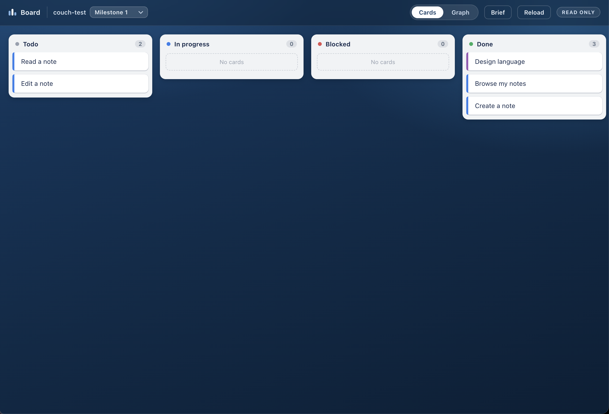
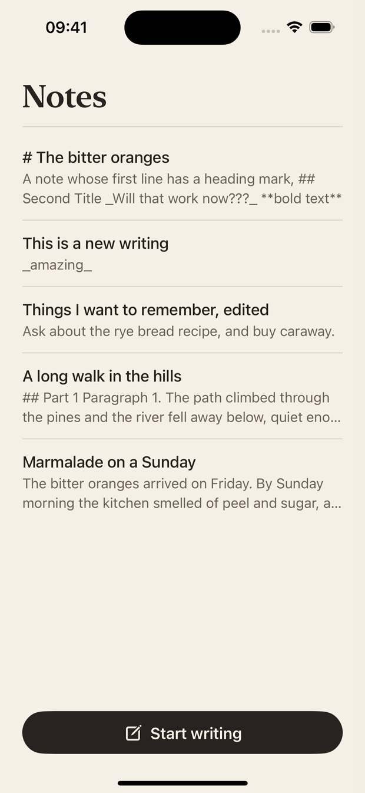
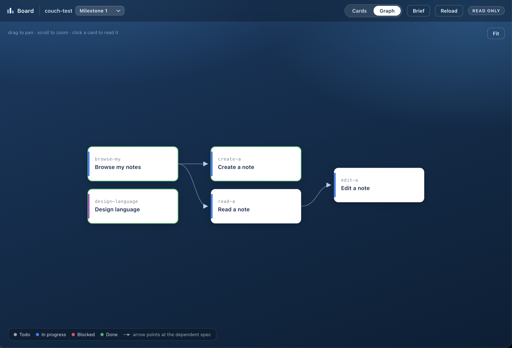
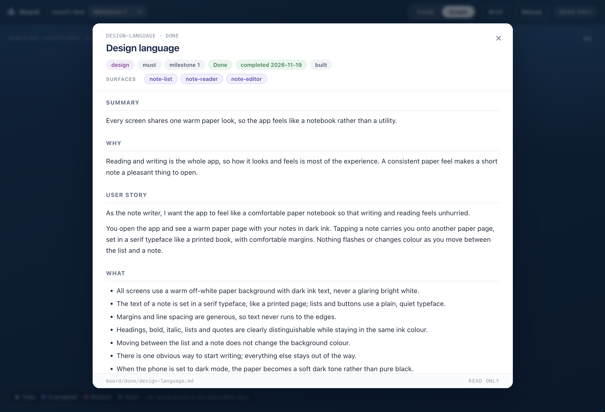

# couch-potator

[](https://github.com/fernandodev/couch-potator/actions/workflows/ci.yml)
[](https://www.npmjs.com/package/couch-potator)
[](LICENSE)

**A spec board that lives in your repository.**

Plain-markdown cards, a read-only viewer, and agent skills for OpenCode and
Claude Code that take an idea from discovery to a verified, squash-merged change
— without a database, a server, or a background process.

```text
board/
├── todo/*.md
├── in-progress/*.md
├── blocked/*.md
└── done/*.md
```

The folder is the status. The file name is the id. The frontmatter is the
metadata. The body is the spec. Your editor, `git diff` and `grep` all work on
it, and so does an agent.

## See it



*`couch-potator view` — one self-contained page, here filtered to milestone 1.*

A notes app planned and built with these skills, running in the iOS Simulator:

[](public/recording.mp4)

*39-second recording of the finished app. Click the poster to play it.*

The dependency graph and a card's spec, as the viewer renders them, are in
[The viewer](#the-viewer) below.

## Contents

- [See it](#see-it)
- [Why couch-potator](#why-couch-potator)
- [Install](#install)
- [Five-minute tour](#five-minute-tour)
- [How a card works](#how-a-card-works)
- [Planning with an agent](#planning-with-an-agent)
- [Unblocking a card](#unblocking-a-card)
- [Implementing with an agent](#implementing-with-an-agent)
- [Command reference](#command-reference)
- [Recipes](#recipes)
- [Milestones](#milestones)
- [Ready cards and the implement queue](#ready-cards-and-the-implement-queue)
- [Verification checks](#verification-checks)
- [Environments](#environments)
- [The viewer](#the-viewer)
- [Dependency graph](#dependency-graph)
- [Configuration](#configuration)
- [Shell completions](#shell-completions)
- [Design notes](#design-notes)
- [Development](#development)
- [License](#license)

## Why couch-potator

Most project trackers are a database with a web UI. Your specs live somewhere
else, your agents cannot read them, and the board drifts from the code.

couch-potator keeps the board in the same repository as the code:

- **One project, one board.** No workspaces, no slugs, no multi-tenant config.
  The board and the app share one git history.
- **The board is the source of truth.** Cards are written in plain language:
  what the owner will see and how to check it. No framework names, no file
  layout, no implementation detail.
- **Agents get a contract.** Four agent skills (mechanics, planning, unblocking,
  implementation) and two subagents read the same board you do, whether you use
  OpenCode or Claude Code. The implementer works in a git worktree, verifies
  acceptance criteria and merges one card at a time.
- **Nothing to run.** `view` writes one self-contained HTML file; everything
  else is a short-lived CLI command.

If it is not on the board, it is not planned. If it is not verified, it is not
done.

## Install

Requires Node 20 or newer.

```sh
npm install -g couch-potator
```

Then run `couch-potator init` inside the project you are building. To try it
without a global install, use `npx couch-potator`:

```sh
npx couch-potator init --name "Reading List"
npx couch-potator init --target claude   # Claude Code instead of OpenCode
```

The package is on npm at
[`couch-potator`](https://www.npmjs.com/package/couch-potator).

Working on couch-potator itself? Install from a checkout instead:

```sh
git clone https://github.com/fernandodev/couch-potator.git
cd couch-potator
npm install
npm run build
npm link            # exposes the `couch-potator` command on your PATH
```

## Five-minute tour

This walkthrough builds a tiny reading-list app. Every command runs inside the
project you are building.

### 1. Start the board

```sh
mkdir reading-list && cd reading-list
git init
couch-potator init --name "Reading List"
```

`init` scaffolds the board, the brief, the config, the viewer target, the
`.gitignore` entries and the agent files:

```text
board/{todo,in-progress,blocked,done}/
PROJECT.md                                          # name, milestone, brief
.couch-potator/config.json                          # paths and verification checks
.couch-potator/templates/card.md                    # default spec body for `add`

# --target opencode (the default)
.opencode/skills/couch-potator-board/SKILL.md       # board mechanics
.opencode/skills/couch-potator-planner/SKILL.md     # product planning
.opencode/skills/couch-potator-unblock/SKILL.md     # re-planning a blocked card
.opencode/skills/couch-potator-implement/SKILL.md   # implementation orchestration
.opencode/commands/unblock.md                       # /unblock prompt
.opencode/commands/implement.md                     # /implement prompt
.opencode/agents/couch-potator-implementer.md       # one-card worker subagent
.opencode/agents/couch-potator-integrator.md        # rebase triage subagent
AGENTS.md                                           # managed board block

# --target claude
.claude/skills/<skill-name>/SKILL.md                # same four skills
.claude/commands/{unblock,implement}.md             # /unblock and /implement prompts
.claude/agents/couch-potator-{implementer,integrator}.md
CLAUDE.md                                           # managed board block
```

`--target` picks the runtime: `opencode` (the default), `claude`, or `both`.
Claude Code gets the `.claude/` layout and a managed `CLAUDE.md` block; OpenCode
keeps its `.opencode/` layout and `AGENTS.md`. Reinstall later with
`couch-potator skill install --target <name>`.

When a newer couch-potator ships changed skills, refresh an existing project
with `couch-potator skill update` (or `couch-potator skill --update`). It detects
the runtimes already installed, rewrites only the managed files whose content
changed, adds files that are new in this version, and leaves matching files
alone. Pass `--target` to refresh one runtime explicitly.

`.couch-potator/viewer/` and `.couch-potator/worktrees/` are appended to
`.gitignore`. Commit `board/`, `PROJECT.md` and the config; leave the generated
page and the implementation worktrees out.

### 2. Add a few cards

A card is one observable outcome. Give it a kind, a milestone, a priority and
the surface it changes:

```sh
couch-potator add "Reading list page" -k foundation -m 1 -p must -s list-screen
couch-potator add "Add a book" -k feature -m 1 -p must -s add-form
couch-potator add "Mark a book as read" -k feature -m 1 -p should -s list-screen
couch-potator add "Remember books between launches" -k foundation -m 1 -p must
```

Then record what waits for what:

```sh
couch-potator dep add add-a-book reading-list-page
couch-potator dep add mark-a-book-as-read add-a-book
```

`list` shows the board:

```text
COLUMN  ID                               KIND        M  TITLE
Todo    reading-list-page                foundation  1  Reading list page
Todo    add-a-book                       feature     1  Add a book
Todo    mark-a-book-as-read              feature     1  Mark a book as read
Todo    remember-books-between-launches  foundation  1  Remember books between launches

4 of 4 cards · 1 milestone
```

### 3. Write the spec

`add` seeds the full spec body from `.couch-potator/templates/card.md`. Fill one
in with your editor:

```sh
couch-potator edit reading-list-page
```

Or replace the body from a file or stdin:

```sh
couch-potator body reading-list-page --file specs/reading-list-page.md
couch-potator body reading-list-page --file - < specs/reading-list-page.md
```

A finished card looks like this:

```markdown
---
id: reading-list-page
title: Reading list page
kind: foundation
milestone: 1
priority: must
order: 10
depends_on: []
related: []
surfaces: [list-screen]
created: 2026-11-16
updated: 2026-11-16
---

## Summary

Opening the app shows every saved book as a list.

## Why

It is the home screen. Without it there is nothing to add a book to.

## User story

As a reader, I want to see the books I have saved so that I can pick one up.

## Acceptance criteria

- [ ] Opening the app shows a list of saved books, newest first.
- [ ] Each row shows the title, the author and whether it is finished.
- [ ] An empty list explains how to add the first book.

## Out of scope

- Search, sorting and filters.
```

### 4. Check, queue and view

```sh
couch-potator check     # ids, links, cycles, orders, surface collisions
couch-potator next      # what is ready to build, in what order
couch-potator view      # generate and open the board
```

`next` reads the current milestone and prints a build plan:

```text
Reading List — milestone 1
Milestone: 0 done · 0 in progress · 0 blocked · 4 todo
Parallel: 1 slot(s), 1 free
Next: reading-list-page — Reading list page (must)

Batch (1 of 1 free slot(s))
- reading-list-page — Reading list page (must) [list-screen]

Held back
- remember-books-between-launches — does not declare surfaces; add them to run it alongside another card

Waiting
- add-a-book — Add a book; waiting on reading-list-page (todo)
- mark-a-book-as-read — Mark a book as read; waiting on add-a-book (todo)

Blocked
- none

In progress
- none

Done
- none
```

### 5. Build it

In an OpenCode or Claude Code session in the project:

```text
/implement
```

The skill asks for your verification commands once, then builds the ready cards
one at a time, verifying each against its acceptance criteria. When it finishes,
the card has moved to `done/` with a verification note and the code is merged.

Refresh the viewer and the card is in the last column.

## How a card works

```markdown
---
id: add-a-book
title: Add a book
kind: feature            # foundation | design | feature | quality | release | fix
milestone: 1
priority: must           # must | should | could
order: 20                # position inside a column
depends_on: [reading-list-page]
related: [book-details]
environments: [browser]    # runtime needed to check it
surfaces: [add-form]      # what the owner can point at
blocked_reason:
completed:
resolution:
created: 2026-11-16
updated: 2026-11-16
---

## Summary
## Why
## User story
## What
## Acceptance criteria
## Out of scope
## Dependencies
## Decisions
```

| Field | Meaning |
| --- | --- |
| `kind` | `foundation`, `design`, `feature`, `quality`, `release` or `fix`. Used for colour, ordering and filtering. |
| `milestone` | Whole number. Only the current milestone is built. |
| `priority` | `must`, `should` or `could`. Drives the implement queue. |
| `order` | Position inside a column; `move` renumbers both columns. |
| `depends_on` | Cards that must be `done/` first. Cycles are rejected. |
| `related` | Loose links shown as chips; not a build dependency. |
| `surfaces` | What the owner can point at (`list-screen`, `settings`, `billing`). Two cards that share one never build at the same time. |
| `blocked_reason` | Why the card sits in `blocked/`. |
| `completed` / `resolution` | Filled by the implementer when the card lands. |

A surface is one token: `-s list-screen`. Pass `-s` once per surface
(`-s list-screen -s add-form`) or comma-separate them
(`-s list-screen,add-form`).

`status` is never stored: the folder is the status. Unknown frontmatter keys are
preserved on every write, so custom fields survive `set`, `move` and `body`.

The body is a plain-language contract:

- **Summary** — the outcome in one or two sentences.
- **Why** — the problem and who feels it.
- **User story** — the person, the outcome and the reason, plus a short narrative.
- **What** — observable behaviour only. No frameworks, no file layout.
- **Acceptance criteria** — 3–7 things a person can check.
- **Out of scope** — what this card deliberately does not do.
- **Dependencies** — the card ids it waits for, if the graph is not enough.
- **Decisions** — dated answers the owner gave.

Edit `.couch-potator/templates/card.md` to change the default body for new
cards.

## Planning with an agent

`init` installs four agent skills, for OpenCode or Claude Code depending on
`--target`:

| Skill | Job |
| --- | --- |
| `couch-potator-board` | Board mechanics: read, add, body, move, link, validate, view. |
| `couch-potator-planner` | Product planning: discovery, specs, milestones, questions, review. |
| `couch-potator-unblock` | Unblocking: explain the block, ask the open questions, record the answers, return the card to `todo`. |
| `couch-potator-implement` | Implementation: pick ready cards, run one worker per card in its own worktree, verify, merge one at a time. |

The planner is the product manager. It does not write your product's code. It:

- reads `PROJECT.md` and the board before every session;
- asks the owner questions in small batches through the agent's question tool
  (`question` in OpenCode, `AskUserQuestion` in Claude Code), with concrete
  options and a recommendation;
- writes cards and the brief as the answers arrive, not at the end;
- uses `couch-potator` for every card change;
- puts ready cards in `todo/` and cards with an open question in `blocked/`;
- stops when the owner agrees the current milestone is enough.

It discusses only *what* and *why*. Frameworks, libraries, file layout and code
belong to the implementer, not the planner.

To start, open an OpenCode or Claude Code session in the project and ask:

```text
Use the couch-potator-planner skill. This is a reading-list app for one person.
Plan milestone 1 with me, a few questions at a time.
```

If the board is missing, run `couch-potator init` first. The planner will tell
you the same.

The planner fills `PROJECT.md` with vision, audience, journeys, non-goals,
constraints, stack decisions, design direction, glossary, milestones, decisions,
open questions, working state and later ideas. It never overwrites an existing
brief.

## Unblocking a card

A blocked card carries a `blocked_reason` and a `## Decision needed` section
with the owner's open questions. Start an unblock session with:

```text
/unblock                 # list the blocked cards and ask which one
/unblock <card>          # unblock one card
/unblock all             # every blocked card, one at a time, in id order
/unblock all -m 2        # only milestone 2
```

The `couch-potator-unblock` skill shows the reason and the open questions before
asking anything, then asks in small batches through the agent's question tool,
with a recommendation for each. It writes every answer to the card's
`## Decisions` and, when the answer is project-wide, to the decision log in
`PROJECT.md`. It then clears `blocked_reason`, removes the answered
`## Decision needed` section, and moves the card to `todo/` once it meets the
Definition of Ready. If an answer is still missing, the card stays in
`blocked/` with only the remaining question.

It never builds. The skill is hidden from automatic selection; `/unblock` loads
it explicitly.

## Implementing with an agent

`couch-potator-implement` is the build counterpart to the planner. It reads the
board, picks the next ready cards, gives each one to a **fresh implementer
subagent** in its own git worktree, verifies the acceptance criteria, and merges
the cards into the base branch one at a time.

```text
/implement                 # build the current milestone, one card at a time
/implement --parallel 2    # up to two cards at once (the hard cap is 3)
/implement --one           # stop after one batch is integrated
/implement --dry-run       # print the plan and change nothing
```

It never writes your product's code itself, never invents product behaviour and
never starts the next milestone. If the board is ambiguous it stops and asks,
through the same question tool the planner uses.

Before the first run it asks for the verification commands once and stores them
with `couch-potator checks` (see [Verification checks](#verification-checks)).
`fast` commands run on every card branch, after every rebase and after every
merge; `full` commands run once when the milestone is built.

How a run works:

1. It reads `PROJECT.md` and the board, and refuses to start on validation
   errors, a dirty git tree or a non-`active` project.
2. `couch-potator next` picks the batch: current milestone only, dependencies
   done, ordered by priority, board order, kind and id, with cards that share a
   `surface` kept apart.
3. Each card moves to `in-progress/` and gets a branch `spec/<card-id>` and a
   worktree at `.couch-potator/worktrees/spec-<card-id>`.
4. One worker per card implements **one** card, runs the fast checks and returns
   a `STATUS: DONE` or `STATUS: BLOCKED` report. A worker starts a runtime only
   when the orchestrator assigned it an environment slot.
5. The orchestrator reviews the diff, runs the fast checks, witnesses every
   acceptance criterion and rebases onto the current base. Witnessing starts as
   soon as a branch is ready, while the rest of the batch is still being built;
   when several cards share a single-instance environment, their checks collapse
   into one preview build and one launch. A conflicted rebase goes to the
   `couch-potator-integrator` subagent, which may only make *mechanical*
   adaptations; a product conflict blocks the card.
6. The card is squash-merged as one commit, moved to `done/` with a
   `## Verification` section, and the worktree and branch are removed.
7. Blocked cards go to `blocked/` with a `## Decision needed` section; the
   branch is kept so the work survives.

It never pushes, never forces, never merges two branches at once, and never
marks a card done without verification. `--parallel` bounds how many cards are
**built** at once; `concurrency` in `config.json` bounds how many runtimes are
**checked** at once. A single-instance product still builds cards in parallel and
queues their checks; see [Environments](#environments).

Workers run on your machine, so they are held to three safety rules. A worker
stops only processes it started, by recorded PID, and never uses `pkill`,
`killall` or a pattern kill. Before any synthetic keystroke or click it confirms
its own window is frontmost, and it prefers accessibility APIs, test hooks or an
HTTP API over simulated input. Scratch files, fixtures and evidence stay under
the worktree or `$TMPDIR`, never a bare `/tmp` path or another project's folder.

If the project root is not a git repository yet, the skill initializes one
automatically — but it stops and asks if the staged files look like secrets or
build output, or if no git identity is configured.

## Command reference

Global flags: `--root <path>` and `--version`. Every command accepts
`-h` or `--help`; `couch-potator help <command>` prints the same text. Help
covers usage, arguments, options, notes and examples, and never reads the board,
so it works outside a project too.

Exit codes: `0` success, `1` invalid board or failed validation, `2` usage error
(unknown card, unknown column, bad flag).

### Scaffold and inspect

| Command | Effect |
| --- | --- |
| `couch-potator init [--name <n>] [--target opencode\|claude\|both] [--no-skill] [--force]` | Scaffold a board in the current folder. Idempotent; never overwrites `PROJECT.md`. `--target` picks the agent runtime (default `opencode`); `--no-skill` skips the agent files; `--force` rewrites them. |
| `couch-potator list [-c <col>] [-m <n>] [-k <kind>] [--all] [--json] [--ids]` | List cards, sorted by status, then `order`, then title. |
| `couch-potator show <card> [--raw\|--path\|--json]` | Print a spec, its file path or its JSON. `<card>` may be an id or a unique prefix. |
| `couch-potator check [--strict] [--json]` | Validate ids, links, cycles, orders, columns, environments and in-progress surface collisions. Exit 1 on errors; `--strict` also fails on warnings. |
| `couch-potator next [--parallel <1-3>] [--json]` | Pick the next ready cards, in dependency/priority/order/kind order, and report the batch, held-back, waiting, blocked and in-progress cards plus the environment pools. |
| `couch-potator graph [--format text\|mermaid\|dot] [-m <n>]` | Print the dependency graph without a browser. |
| `couch-potator view [--watch] [--no-open] [--milestone <n\|all>] [--out <path>]` | Generate and open the read-only viewer. |
| `couch-potator help [command]` | Print the command list, or usage, arguments, options, notes and examples for one command. |

### Cards

| Command | Effect |
| --- | --- |
| `couch-potator add "<title>" [-c todo] [-k feature] [-m 1] [-p must] [-o 10] [-s <surface>]... [-e <environment>]... [-d <card>]... [-r <card>]... [--body <file\|->] [--json]` | Create a card. `-c` accepts `wip`/`inprogress` for `in-progress`. Repeat `-d` and `-r`; `-s` and `-e` may repeat or be comma-separated. |
| `couch-potator body <card> --file <file\|->` | Replace a card body. Use `-` to read stdin. |
| `couch-potator move <card> <column> [--top\|--bottom\|--before <card>\|--after <card>]` | Move a card and renumber both columns. |
| `couch-potator set <card> <field> <value>` | Set `kind`, `milestone`, `priority`, `order`, `title`, `surfaces`, `environments`, `blocked_reason`, `resolution` or `completed`. Use `-` to clear. |
| `couch-potator edit <card>` | Open the spec in `$VISUAL`/`$EDITOR`. |
| `couch-potator rm <card> [--force]` | Delete a card. |

### Relationships

| Command | Effect |
| --- | --- |
| `couch-potator dep add\|rm <card> <card>` / `dep <card>` | Edit or list `depends_on`. Cycles are rejected. |
| `couch-potator rel add\|rm <card> <card>` / `rel <card>` | Edit or list `related`. |

### Agents and shell

| Command | Effect |
| --- | --- |
| `couch-potator checks [--json]` / `checks set <fast\|full> <name> "<command>"` / `checks clear <fast\|full> [name]` | Show or edit the verification commands the implement skill runs. |
| `couch-potator skill install [--target opencode\|claude\|both] [--force]` / `skill update [--target ...]` | Install the agent files, or refresh them to this version. Update detects installed runtimes, rewrites changed files and adds new ones without touching files that already match. `--update` is an alias for the update action. |
| `couch-potator completion [install] [bash\|zsh\|fish] [--print] [--no-rc]` | Print or install shell completions (`sh` maps to bash). |

## Recipes

```sh
# Add a card that waits for another, on a surface it changes
couch-potator add "Checkout" -k feature -m 1 -p must -d cart -s checkout

# Move a card to the top of its column
couch-potator move checkout in-progress --top

# Read the raw markdown, or just the path, for an agent or a diff
couch-potator show checkout --raw
couch-potator show checkout --path

# Every todo id in the current milestone, one per line
couch-potator list -c todo -m 1 --ids

# The whole board as JSON
couch-potator list --json

# A milestone's dependency graph as Mermaid or Graphviz
couch-potator graph -m 1 --format mermaid
couch-potator graph -m 1 --format dot
```

## Milestones

Milestones are whole numbers. The set in the viewer is the union of the values in
`PROJECT.md` (`current_milestone` and the optional `milestones: [1, 2]` list) and
the `milestone` of every card, so you can declare a milestone before its first
card.

Only `current_milestone` is built. When every card in it is `done/`, the
implement skill runs the full checks once and stops for review. It never moves
the pointer to the next milestone — that is a planning decision.

The viewer opens on `current_milestone`, falling back to the newest milestone.
The header dropdown filters cards and graph together; the choice is kept in the
URL hash. Cards with no milestone only appear under **All milestones**.

```sh
couch-potator list -m 2          # one milestone
couch-potator view -m all        # every card
couch-potator graph -m 2         # the milestone's dependency graph
```

## Ready cards and the implement queue

`couch-potator next` is the implementation planner. It reads the current
milestone from `PROJECT.md` and picks the cards that are ready to build:

- a card is ready when it is in `todo/` for the current milestone, has no open
  question, and every card in its `depends_on` is `done/`;
- ready cards are ordered by priority (`must`, `should`, `could`), then the
  board order, then kind (`foundation`, `feature`, `design`, `quality`, `fix`,
  `release`), then id;
- at most `--parallel` cards are offered (`1` by default, `3` at most), and two
  cards that share a surface never appear in the same batch;
- a card with no `surfaces` is treated as unknown and offered alone;
- cards already in `in-progress/` are resumed first and take both a slot and
  their surfaces.

A batch is a ceiling, not a target: a single card at width three is normal.
`--parallel 9` runs three and says so in the warnings.

```sh
couch-potator next --parallel 2
```

```text
Reading List — milestone 1
Milestone: 0 done · 0 in progress · 0 blocked · 4 todo
Parallel: 2 slot(s), 2 free
Next: reading-list-page — Reading list page (must)

Batch (1 of 2 free slot(s))
- reading-list-page — Reading list page (must) [list-screen]

Held back
- remember-books-between-launches — does not declare surfaces; add them to run it alongside another card

Waiting
- add-a-book — Add a book; waiting on reading-list-page (todo)
- mark-a-book-as-read — Mark a book as read; waiting on add-a-book (todo)
…
```

`--json` returns the same information for an agent: `batch`, `held_back` with a
reason each, `waiting` with the unresolved dependencies, `blocked`, `done`,
`in_progress`, `eligible`, `slots`, `environments`, `errors` and `warnings`. The
command exits `1` when the board has validation errors, so an implementer can
stop before building.

`couch-potator check` validates the board. `couch-potator next` only reads it.

## Verification checks

`couch-potator check` (singular) validates the board. `couch-potator checks`
(plural) is the list of commands the implement skill runs to verify a card.
They live in `.couch-potator/config.json` and are grouped by when they run:

- **fast** — install, test, lint and typecheck. Run on every card branch, after
  every rebase and after every merge.
- **full** — build and package. Run once on the base branch when the milestone
  is complete, not per card.

```sh
couch-potator checks
couch-potator checks --json
couch-potator checks set fast install "npm ci"
couch-potator checks set fast test "npm test"
couch-potator checks set fast lint "npm run lint"
couch-potator checks set fast typecheck "npm run typecheck"
couch-potator checks set full build "npm run build"
couch-potator checks clear fast lint
couch-potator checks clear full
```

A stack that does not need a step simply leaves it out; an empty phase is not a
failed check. `--json` prints `{ "fast": { ... }, "full": { ... } }` for an
agent. The implement skill asks for the commands once, writes them here, and
reuses them.

## Environments

A card with `surfaces` needs a runtime before anyone can say it works: a browser,
a desktop window, a simulator, an emulator, a staging service. When two instances
of that runtime would collide — a port, a data folder, a device, a single window,
a single-instance lock — the runtime is an **environment**.

Declare the ones this project has in `.couch-potator/config.json`:

```json
{
  "environments": {
    "browser": { "concurrency": 3, "hint": "npm run dev -- --port $SLOT_PORT" },
    "ios-sim": { "concurrency": 2, "hint": "xcrun simctl clone iPhone-16 slot-$SLOT" },
    "mac-app": { "concurrency": 1 }
  },
  "default_environment": "browser"
}
```

`concurrency` is how many isolated instances may exist at the same time. `hint`
is how instance *n* differs from instance *n-1*: its port, bundle identifier,
data folder, simulator or emulator name. Agents read it before launching
anything. `default_environment` is used when a card does not name one; with a
single environment it can be omitted.

A card names the environments it needs:

```yaml
surfaces: [board-screen]
environments: [browser]
```

or, from the CLI, `couch-potator add "..." -e browser` and
`couch-potator set <card> environments "browser, staging-api"`. A card without
`surfaces` needs no environment, because unit tests and linters do not start a
server or a window. A visible card with no explicit environment uses
`default_environment`, then the only declared environment, then one implicit
`app` slot — so an older project keeps working and stays safe.

The width and the pool are different things:

- `--parallel N` is **work width**: how many cards may be edited at once.
  Surfaces still keep two cards on the same screen apart.
- `concurrency` is **witness width**: how many instances may be built and
  checked at once.

A project with one `mac-app` slot is not forced back to one card at a time. Three
cards can be built in parallel and their visual checks queue behind the single
instance; the implementer collapses a queue into one build and one launch when
it can (see [Implementing with an agent](#implementing-with-an-agent)). A web
project with `browser: 3` can check three cards at once.

`couch-potator next` reports both, and counts the instances already held by
cards in `in-progress/`:

```text
Parallel: 3 slot(s), 3 free
Environments: browser — 0/3 in use · mac-app — 1/1 in use
```

An environment a card names but the project does not declare is a warning and
runs alone. `couch-potator check` also warns when several environments are
declared without a `default_environment`.

## The viewer

`couch-potator view` writes one self-contained file to
`.couch-potator/viewer/board.html`:

- cards grouped into the four columns, titles only, coloured by `kind`
- clicking a card opens the rendered spec with metadata chips, clickable
  `depends_on` / `related` links, `surfaces` chips and the file path
- `Brief` opens `PROJECT.md`
- `Cards` / `Graph` toggle
- `Reload` re-reads the latest page; card commands rewrite the file automatically

```sh
couch-potator view                  # write and open
couch-potator view --no-open        # write only
couch-potator view --watch          # rebuild on any board change, then Reload
```

Once a viewer exists, every command that changes a card rewrites it in place, so
the open page shows the current board after `Reload` without running `view`
again. `--watch` also catches edits made outside the CLI, such as a hand-edited
card or brief.

It is structurally read-only: there is no server, no `fetch`, no write endpoint
and no drag handler. Markdown is rendered with marked and sanitised with
DOMPurify, both inlined into the page. The page works over `file://`, so it can
be emailed or committed as a build artifact if you really want to.



*`Cards` / `Graph` toggles the dependency graph for the selected milestone.*



*Clicking a card opens its rendered spec, with metadata chips, surface chips and
the file path.*

## Dependency graph

`A depends_on B` draws an arrow from `B` to `A` — the arrow points at the
dependent card. The viewer layers the graph left to right by longest path, and
hovering a node dims everything except its neighbours.

When a milestone is selected, specs from other milestones that a visible card
depends on (or that depend on it) stay in the graph, drawn faded with dashed
edges, so cross-milestone dependencies remain traceable.

`related` and `surfaces` are not drawn as edges; they appear as chips in the spec
modal.

Without a browser:

```sh
couch-potator graph                       # indented text
couch-potator graph -m 1 --format mermaid  # paste into a Markdown renderer
couch-potator graph --format dot           # pipe into Graphviz
```

## Configuration

`.couch-potator/config.json` is committed to the repository:

```json
{
  "version": 1,
  "board": "board",
  "brief": "PROJECT.md",
  "viewer": {
    "out": ".couch-potator/viewer/board.html"
  },
  "checks": {
    "fast": {
      "test": "npm test",
      "typecheck": "npm run typecheck"
    },
    "full": {
      "build": "npm run build"
    }
  },
  "environments": {
    "browser": { "concurrency": 3 }
  },
  "default_environment": "browser"
}
```

`board` and `brief` are relative to the project root. Missing keys fall back to
the defaults above, so an older config keeps working. `checks` is managed by
`couch-potator checks`; edit it by hand only if you must. `environments` and
`default_environment` describe the runtimes a card may need; see
[Environments](#environments).

`--root <path>` points any command at a different project. Otherwise the CLI
walks up from the current folder to the nearest board.

## Shell completions

Install completions for the shell you use:

```sh
couch-potator completion install fish
couch-potator completion install zsh
couch-potator completion install bash
```

`completion` with no `install` prints the script instead, and `--print` forces
printing even with `install`. Use `--no-rc` to write the script without touching
your shell startup files.

| Shell | File | Wiring |
| --- | --- | --- |
| fish | `~/.config/fish/completions/couch-potator.fish` | Loaded automatically by fish. |
| zsh | `~/.config/couch-potator/completion.zsh` | Managed block in `~/.zshrc`. |
| bash | `~/.local/share/bash-completion/completions/couch-potator` | Managed block in `~/.bashrc`. |

The install is idempotent: rerunning it rewrites the script but keeps a single
managed block, delimited by `# >>> couch-potator completions >>>` and
`# <<< couch-potator completions <<<`. Restart the shell (or open a new tab)
after installing.

Completions are dynamic: the scripts call a hidden `__complete` command, so card
ids, milestones, columns, kinds, formats and flags come from the board you are
standing in. A missing or broken board never breaks the shell; you simply get
commands and flags.

To wire a script by hand:

```sh
source <(couch-potator completion bash)
source <(couch-potator completion zsh)
couch-potator completion fish > ~/.config/fish/completions/couch-potator.fish
```

## Design notes

- **No SQLite.** The directory tree is the index and frontmatter is the metadata.
  Thousands of cards scan in milliseconds, and there is nothing to invalidate.
- **No web server.** A generated single-file page does the same job over
  `file://`, with no ports, no daemon, no "already running" state and no
  stale-server failure mode. The cost is that regeneration is explicit.
- **Files are the source of truth.** The viewer never writes. The CLI can rewrite
  a spec body only through the explicit `body` command.
- **One project.** A board describes one app. Multi-project layouts are not
  supported on purpose: they make the queue, the milestone pointer and the
  implementer's worktree ambiguous.
- **The board and the code share one history.** The board-start commit, the
  squash-merge commit and the card's verification note all land together, so a
  `git log` reads as a build log.

## Development

```sh
npm install
npm run build     # esbuild bundle to dist/ and copy viewer assets
npm test          # Node's test runner over tests/*.test.ts
npm run typecheck
npm run check     # typecheck + tests + build
```

CI runs the same `npm run check` on Node 20, 22 and 24 for every push to
`main`, every pull request and on demand (`.github/workflows/ci.yml`).

The bundle is one `esbuild` invocation (`scripts/build.mjs`). Tests are bundled
with the same esbuild and executed by `node --test` (`scripts/test.mjs`), so the
dev toolchain is esbuild plus TypeScript — no separate bundler or test framework
to keep patched.

The viewer assets live in `src/viewer/assets/`; `scripts/build-assets.mjs` copies
them and the marked/DOMPurify bundles into `dist/assets/` so the published
package has no runtime frontend dependency.

Generated agent files (skills, commands, subagents and the managed instruction
block) are templates in `src/templates.ts`. The same content is rendered for
OpenCode (`.opencode/` + `AGENTS.md`) and Claude Code (`.claude/` + `CLAUDE.md`),
with target-specific frontmatter and tool names. Edit the template, never a
generated copy in a target project, and update the tests and this README in the
same commit.

## License

MIT — see [LICENSE](LICENSE).

Copyright (c) 2026 Fernando Martinez.
